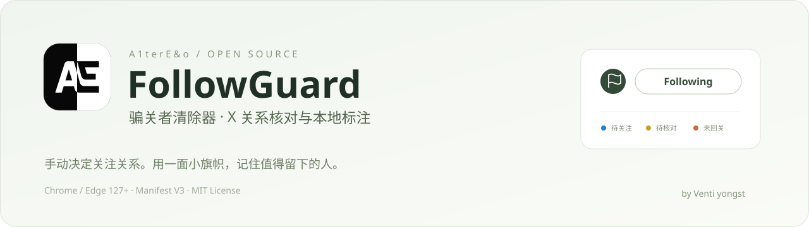
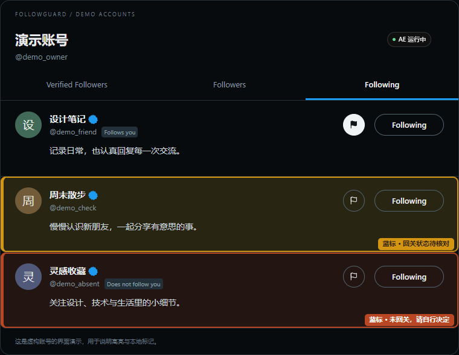
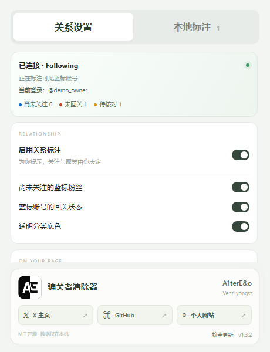
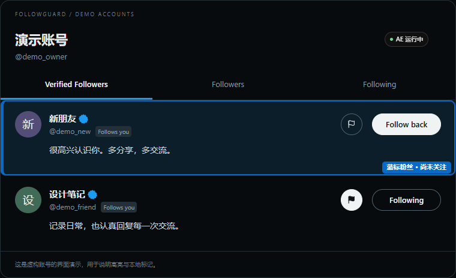
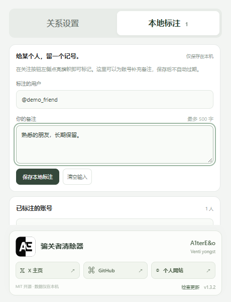

<div align="center">



<p><strong>识别关注关系 · 一键旗帜标记 · 本地保存备注</strong></p>

<a href="https://github.com/YongstVenti/FollowGuard/archive/refs/heads/main.zip"></a>


<a href="LICENSE"></a>

<p><a href="#install">下载安装</a> · <a href="#features">功能说明</a> · <a href="#marks">本地标注</a> · <a href="#updates">检查更新</a> · <a href="#author">关于作者</a></p>

<p><strong>A1terE&amp;o 出品 · 作者 Venti yongst</strong></p>

</div>

---

**FollowGuard（骗关者清除器）** 是一个轻量的 Chrome / Edge 浏览器扩展，用来整理 X 上的关注关系。它会在名单中突出需要你留意的蓝标账号，并提供独立的小旗帜按钮，让你记住某个人、补充备注。

关注、取关及确认操作都由你使用 X 原有按钮完成。无需登录第三方服务，无需填写自己的账号，也不需要大模型或 API Key。

> **判断关系时保持谨慎：没有显示“Follows you / 关注了你”，不等于已经确认对方未回关。无法确认的账号会显示黄色“待核对”。**

## 界面预览

<table>
<tr><th width="64%">名单内直接查看关系与旗帜</th><th width="36%">工具栏弹窗</th></tr>
<tr><td valign="top"></td><td valign="top"></td></tr>
</table>

<sub>以上使用虚构账号演示，截图来自当前扩展。页面样式与名单结构可能随 X 更新而变化。</sub>

<a id="install"></a>

## 下载安装

### 1. 下载并解压

点击 **[下载源码 ZIP](https://github.com/YongstVenti/FollowGuard/archive/refs/heads/main.zip)**，或者点击仓库右上方 **Code → Download ZIP**。

下载后把整个文件夹解压到一个固定位置，例如：

```text
D:\Apps\FollowGuard-main\
```

进入这个文件夹，你应该能直接看到 `manifest.json`、`app.html`、`background.js` 和 `icons` 文件夹。**加载时选择包含 `manifest.json` 的这一层目录。**

### 2. 打开浏览器扩展管理页

| 浏览器 | 在地址栏输入 |
| --- | --- |
| Chrome | `chrome://extensions` |
| Microsoft Edge | `edge://extensions` |

开启页面上的 **开发者模式**，点击 **加载已解压的扩展程序**，选择刚才解压的文件夹。

运行环境：Chrome / Edge **127 或更新版本**。扩展采用 Manifest V3。

### 3. 固定 AE 入口

点击浏览器右上角的扩展图标，在列表中找到 **骗关者清除器 · A1terE&o**，将它固定／显示到工具栏。

工具栏里的黑白 AE 图标可以打开“关系设置”和“本地标注”。网页右下角的 AE 入口也会尝试打开同一个工具栏弹窗，不会在网页内再铺一个设置面板。

### 4. 刷新 X，打开自己的名单

刷新已经打开的 X 页面，再进入个人主页，打开以下任一名单：

- **Verified Followers**：认证粉丝。
- **Followers**：粉丝。
- **Followers you follow**：你也关注的粉丝。
- **Following**：你正在关注的人。

插件会从侧边栏个人主页链接或左下角账号区域自动识别当前登录账号，**不用手动填写用户名**。

### 5. 确认是否连接

打开 AE 弹窗，顶部状态卡会显示：当前是否连接到名单、名单类型、识别到的登录账号以及可见标注数量。

| 状态 | 含义 |
| --- | --- |
| 已连接本人名单 | 可以根据设置突出符合条件的蓝标账号 |
| 已连接他人名单 | 显示连接状态，可以做个人旗帜标记，但不判断本人的回关关系 |
| 等待识别登录账号 | 页面还没有提供足够的登录账号信息，不会根据正在浏览的主页猜测你的身份 |
| 未连接列表 | 当前不是名单页面，或页面尚未刷新／连接到扩展 |

<a id="features"></a>

## 功能说明

### 关系高亮：颜色代表什么？

| 外观 | 出现场景 | 表示什么 | 怎么处理 |
| --- | --- | --- | --- |
| 🔵 蓝框＋透明浅蓝底 | 本人的粉丝名单 | 这是蓝标粉丝，但你尚未关注对方 | 自己判断是否点 Follow back |
| 🟠 橙框＋透明浅橙底 | 本人的 Following | 当前读取到的关系信息，或你确认完整的有效名单，表明对方未回关 | 先核对，再决定是否使用 X 的取关按钮 |
| 🟡 黄框＋透明浅黄底 | 本人的 Following | 暂时无法确认对方是否关注你 | 保留为待核对，不能当成“已确认未回关” |
| 没有关系边框 | 其他情况 | 例如已互关，或者不在这类关系提示的范围 | 仍可以使用个人旗帜标记 |

**自动关系高亮只筛选蓝标账号。** 金标、灰标和无标账号不会因为这套规则被突出；手动旗帜标记则不限蓝标。

高亮贴在用户卡片上，跟随原页面滚动。状态文字预留了自己的位置，不覆盖简介。插件不会替你点击任何关注、取关或确认按钮。

<details>
<summary><strong>展开查看粉丝名单里的蓝色高亮示例</strong></summary>



</details>

### 关系设置：你可以关闭什么？

| 开关 | 作用 |
| --- | --- |
| 启用关系标注 | 暂停／恢复页面提示与标记入口，不清空已经保存的本地数据 |
| 尚未关注的蓝标粉丝 | 控制粉丝名单中的蓝色高亮 |
| 蓝标账号的回关状态 | 控制 Following 中的橙色／黄色提示 |
| 透明分类底色 | 控制边框内的透明填色 |
| 列表顶部运行状态 | 显示／隐藏黑白配绿点的运行提示 |
| 右下角 AE 标志 | 显示／隐藏网页入口；浏览器工具栏入口仍可使用 |

网页 AE 固定在 Grok 上方，不可拖动。运行提示与顶部用户名保持同一水平线，横向对齐名单里用户关注按钮所在的那一列。

<a id="marks"></a>

## 本地标注：一面旗帜，记住一个人

### 在名单里一键标记

每个人的关注按钮左侧都有一个 **圆形旗帜按钮**：直径与关注按钮高度一致，两者垂直居中，中间留出 16px 间距。

1. 点击旗帜：点亮，保存这个账号的本地标记。
2. 再点一次：熄灭，取消点亮状态。
3. 旗帜操作只修改本地记录，不会触发 Follow、Follow back 或 Unfollow。

旗帜使用自己的黑白配色：不会随着 Following 悬停变成红色，也不会复制 Follow back 的白底导致图案看不清。

### 给账号补充备注

打开 AE → **本地标注**：

1. 填写对方的 `@用户名`。
2. 写下备注，例如“老朋友，保留”“等几天再核对”“这个账号的文章值得看”。
3. 点击 **保存本地标注**。
4. 下方的已标注列表支持按用户名／备注搜索，也支持编辑与删除。



### 点亮状态与备注怎样保存？

| 操作 | 结果 |
| --- | --- |
| 点亮空旗帜 | 保存一个不带文字的个人标记 |
| 保存文字备注 | 保存备注，并点亮旗帜 |
| 熄灭已有文字备注的旗帜 | 取消点亮，文字备注继续保留在本地 |
| 熄灭不带备注的旗帜 | 移除这条纯旗帜标记 |
| 在本地标注页删除记录 | 删除这个账号的旗帜与文字备注 |

标记按 **`@用户名`** 绑定，不自动过期。最多保存 **2,000 个账号**，每条备注最多 **500 字**。同一个浏览器扩展内刷新页面、重新打开浏览器或沿用原安装目录更新，都不会主动清空这些记录。

用户名发生变化后不会自动追踪改名。卸载扩展或清除扩展数据会移除记录，详情见 [隐私说明](PRIVACY.md)。

## 完整名单核对：可选功能

如果你确实需要用名单辅助核对回关关系：

1. 打开自己**完整的 Followers 名单**，不是 Verified Followers 子列表。
2. 自己浏览名单，扩展只收集当前可见的账号，不自动滚动或翻页。
3. 打开 AE → 关系设置 → **完整名单核对**。
4. 确认真的已经浏览并收集全部粉丝后，再点击 **确认名单完整**。
5. 完整确认在 **5 分钟内**有效，之后回到待核对状态。你也可以清空名单重新收集。

> 部分名单不能代表全部粉丝。没有完整浏览时不要确认完整，否则可能造成判断错误。

名单每个账号最多 20,000 条，最多保留 5 个账号。超过容量或收集状态过期时，扩展会提示重新核对。

<a id="updates"></a>

## 检查更新与手动升级

作者栏右下角显示当前版本，点击 **检查更新** 后：

1. 首次使用时，浏览器可能询问是否允许连接 `api.github.com`。
2. 获得授权后，扩展读取 **[YongstVenti/FollowGuard](https://github.com/YongstVenti/FollowGuard)** 的最新正式 GitHub Release。
3. 有更高版本时，显示前往发布页的链接。
4. 没有正式 Release、网络失败或请求额度不足时，会如实提示。

**检查的是正式 Releases，不是普通提交。** 下载源码的 main 分支可能先于正式版本更新。扩展不会自动下载、执行远程代码或替换你的安装文件。

手动升级时，把新包里的文件覆盖到**原来的安装目录**，在浏览器扩展管理页点击重新加载，然后刷新 X。沿用原安装路径可以保留该扩展的本地记录。

## 数据与权限

| 项目 | 说明 |
| --- | --- |
| 账号识别 | 读取 X 当前可见的登录账号区域，无需第三方登录 |
| 本地记录 | 旗帜状态、备注、开关和可选名单存于浏览器扩展本地存储 |
| 基础权限 | 只有 `storage` |
| X 页面范围 | 仅 `x.com` 与 `twitter.com` 的内容脚本 |
| 更新连接 | 手动检查时请求 GitHub API 的可选站点授权 |
| 私信与敏感信息 | 不读取私信、Cookie、密码或支付信息 |
| 账户数据上传 | 不上传用户名单、旗帜标记或备注 |
| 统计与模型 | 无遥测统计，无大模型，无 API Key |

手动点击作者链接或赞助入口后，将进入相应外部网站；检查更新时 GitHub 可以接收正常的网络连接信息。完整说明见 [PRIVACY.md](PRIVACY.md)。

## 常见问题

<details>
<summary><strong>没有看到高亮或运行提示？</strong></summary>

先确认你已刷新 X，浏览器中的扩展处于启用状态，且当前打开的是名单页面。工具栏弹窗会显示连接状态与识别到的账号。自动关系判断仅在本人的名单生效。

若同时保留原回复插件，请关闭原插件里的两项蓝标关系标注，避免两套提示同时运行。

</details>

<details>
<summary><strong>黄色是不是代表对方没有回关？</strong></summary>

不是。黄色表示目前无法确认。只有读取到明确关系信息，或者使用你确认完整且仍有效的粉丝名单时，才有条件显示橙色未回关提示。

</details>

<details>
<summary><strong>网页 AE 点了没有打开弹窗？</strong></summary>

需要 Chrome / Edge 127 或更新版本。浏览器若拒绝从网页打开工具栏弹窗，请直接点击浏览器右上角已固定的 AE 图标。

</details>

<details>
<summary><strong>可以自动关注或自动取关吗？</strong></summary>

FollowGuard 提供关系提示和本地标记。关注、取关以及 X 的确认对话框，全部由你自己点击原有按钮完成。

</details>

<details>
<summary><strong>为什么 X 改版后可能需要修复？</strong></summary>

扩展读取网页可见内容，X 的名单结构、认证图标或文案变化可能影响识别。欢迎在 [Issues](https://github.com/YongstVenti/FollowGuard/issues) 提供浏览器版本、扩展版本、名单类型，以及隐去隐私后的截图。

</details>

## 开发与参与

运行时使用原生 HTML、CSS、JavaScript，**无需构建、无需安装运行依赖**。克隆后可直接加载仓库根目录。

```text
FollowGuard/
├─ manifest.json               扩展声明与权限
├─ app.html / app.css / app.js  设置、本地标注、作者区
├─ background.js               消息校验、设置与工具栏弹窗
├─ identity.js                 登录账号与名单识别
├─ relationship-assistant.js   可见名单、高亮、圆形旗帜
├─ relationship-core.js        关系判断规则
├─ relationship-state.js       可选完整名单存储
├─ notes.js                    持久标记与备注
├─ updates.js                  GitHub 正式版本检查
├─ author.json                 作者赞助与更新仓库配置
├─ icons/                      AE 图标
├─ docs/assets/                README 演示图
└─ tests/                      本地标记与版本检查测试
```

修改文件后，在扩展管理页重新加载，再刷新 X。单元测试使用 Node.js 内置测试工具：

```bash
npm test
```

不需要安装 npm 依赖。建议使用 Node.js 20 或更新版本执行测试；普通用户安装浏览器扩展不需要 Node.js。

发布正式版本时，先更新 `manifest.json` 版本号，再创建 `v1.3.2` 这样的 GitHub Release 标签，并附上可解压加载的扩展 ZIP。检查更新入口会读取正式 Release。

<a id="author"></a>

## 关于作者

<table>
<tr><td width="90"></td><td><strong>A1terE&o</strong><br>作者：<strong>Venti yongst</strong><br><br><a href="https://x.com/abc123953468547">𝕏 X 主页</a>　·　<a href="https://github.com/YongstVenti">GitHub</a>　·　<a href="https://aexporter.uk">aexporter.uk</a></td></tr>
</table>

喜欢这个工具，可以给仓库点一个 Star，或通过 Issue 提供使用反馈。

## 许可

代码采用 [MIT License](LICENSE)，允许使用、修改和分发，请保留版权声明。A1terE&o 品牌与 AE 标志用于识别作者产品；第三方修改版不代表作者背书。

<div align="center"><sub>FollowGuard · A1terE&o · Crafted by Venti yongst</sub></div>
